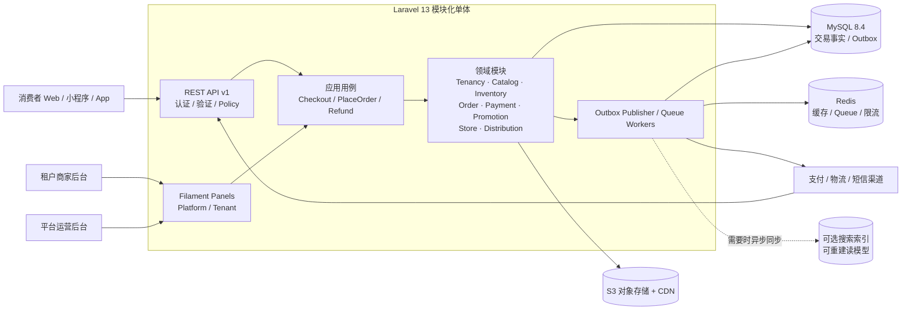
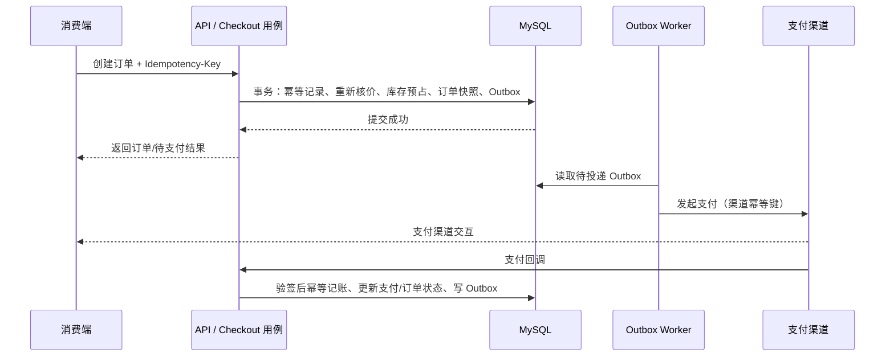
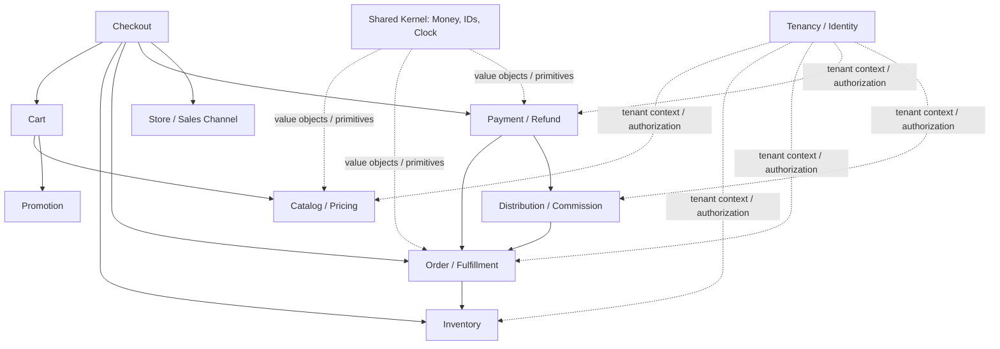
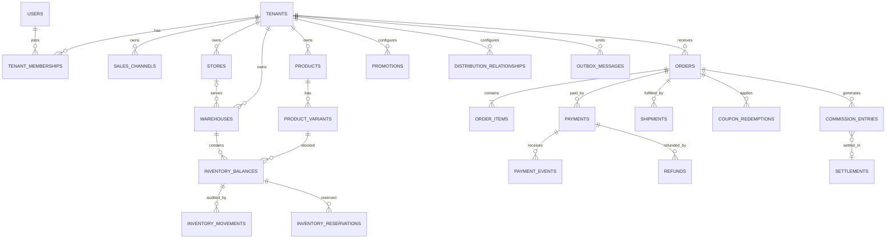

# 系统架构、模块目录与数据库表结构初稿

> 状态：设计初稿，2026-11-03。用于指导项目骨架和后续迁移设计；不是已部署架构，也不是可直接执行的 SQL。字段类型、索引、外键和状态枚举需结合实际渠道、税务、隐私与容量评审后，以 Laravel migrations 实现并通过测试验证。

## 1. 总览：系统上下文与部署结构

采用 Laravel 模块化单体。API 与 Filament 后台共享业务用例，不共享 UI 授权假设。关系数据库是交易事实来源，Redis 提供缓存/队列，Outbox 负责可靠地将已提交事实传递给外部系统和异步消费者。



### 1.1 关键数据流



流程要求：

- 事务内只操作本地数据库，不在持有数据库锁时等待支付/物流 HTTP 请求。
- 订单、订单行快照、库存预占和 Outbox 在同一事务提交；具体下单/支付顺序由业务策略确定。
- 支付回调验签与校验商户、金额、币种、订单关联和事件唯一性后，才可进行幂等状态转换。
- 队列采用至少一次投递假设，消费者必须幂等；Outbox 发布后标记投递状态，失败可重试、告警、人工重放。
- 搜索、缓存、通知属于派生数据/副作用，不能反向成为订单和库存的权威来源。

## 2. 模块边界与依赖方向



箭头表示用例协作或依赖，不代表模块可以任意读写对方的表。模块间通过应用接口、明确的领域事件或只读查询接口协作；避免循环依赖。`Shared` 只放稳定、少量的跨域概念，不能成为业务逻辑杂物箱。

### 2.1 推荐代码目录

```text
app/
├── Modules/
│   ├── Tenancy/
│   │   ├── Domain/              # Tenant, Membership, tenant resolution rules
│   │   ├── Application/         # ResolveTenant, InviteMember use cases
│   │   ├── Infrastructure/      # Eloquent persistence, middleware adapters
│   │   └── Http/                # Tenant API endpoints, requests, resources
│   ├── Catalog/                 # Product, Variant/SKU, Category, Price
│   ├── Store/                   # SalesChannel, Store, Warehouse, fulfillment options
│   ├── Inventory/               # Balance, Movement, Reservation
│   ├── Cart/                    # Cart and cart items
│   ├── Promotion/               # Rules, coupons, redemption
│   ├── Checkout/                # Quote, price calculation orchestration, PlaceOrder
│   ├── Order/                   # Order, snapshots, status history, returns
│   ├── Payment/                 # Payment attempts, channel adapters, refunds, webhooks
│   ├── Distribution/            # Relationships, commission ledger, settlements
│   └── Shared/                  # Money/currency, IDs, clock abstractions
├── Filament/
│   ├── Platform/                # Platform operator Panel
│   └── Tenant/                  # Tenant staff Panel
└── Providers/                   # Composition root / service providers

database/
├── migrations/                  # 按领域拆分命名；迁移顺序明确
├── factories/
└── seeders/
routes/
├── api.php
└── web.php
tests/
├── Unit/Modules/
├── Feature/Modules/
├── Architecture/                # 模块依赖/租户隔离规则
└── Support/                     # fixtures, test helpers
```

不要求从第一天为每个 CRUD 建立四层目录。随着业务规则出现再抽取 Domain/Application 边界；控制器和 Filament Resource 保持薄，统一调用可测试的用例。

## 3. 数据库建模约定

### 3.1 通用约定

- 默认共享数据库、共享表多租户；租户业务表使用 `tenant_id`，不得从客户端请求体直接信任该值。
- ID 使用稳定内部主键（可采用 BIGINT 或 UUID/ULID；初始化阶段统一决策）。订单号、SKU、支付渠道单号等业务标识使用独立字段。
- 金额以最小货币单位整数存储，并同时记录 ISO 4217 `currency_code`；禁止浮点金额。数量根据单位精度使用整数或明确精度的定点数。
- 时间戳统一 UTC；租户/门店 IANA 时区存于配置并在展示时转换。
- 表名复数 snake_case；外键、唯一键和查询索引通过 migration 明确声明。常用租户查询的唯一约束优先使用 `(tenant_id, business_key)`。
- 订单商品、价格、地址、配送方式和收件信息需要不可变快照，避免商品/地址编辑导致历史订单变化。
- 库存流水、支付事件、退款和佣金账目为审计事实；优先追加记录/状态历史，不使用级联删除抹除财务事实。
- `created_at`/`updated_at` 依表用途选择；审计/流水可仅追加。个人信息字段按最小化原则设计加密、脱敏、保留与删除策略。
- 状态用受控状态机和合法迁移，不对外开放任意状态赋值。状态历史写入 `*_status_histories` 或审计事件。

### 3.2 多租户外键与约束

对有租户归属的核心实体，除了应用层授权，尽可能通过复合唯一键和复合外键确保关联不会跨租户。例如 `products` 定义唯一键 `(tenant_id, id)`，订单行若引用商品则关联 `(tenant_id, product_id)`。实际是否由 MySQL migration/ORM 直接实现复合外键，须在选定 ID 类型和 ORM 映射后验证；不能实现时，必须由应用用例验证并增加跨租户写入测试。

唯一键例：

```text
products:            UNIQUE (tenant_id, id), UNIQUE (tenant_id, slug)
product_variants:    UNIQUE (tenant_id, id), UNIQUE (tenant_id, sku)
orders:              UNIQUE (tenant_id, id), UNIQUE (tenant_id, order_no)
idempotency_keys:    UNIQUE (tenant_id, operation, key_hash)
payment_events:      UNIQUE (tenant_id, provider, provider_event_id)
```

高频索引从查询模式出发设计，不对每列机械加索引；复合索引列顺序遵循常见过滤与排序条件，压测和 `EXPLAIN` 结果用于验证。

## 4. 数据库实体关系总览

以下 Mermaid 是概念关系，不含所有列和可选关联；字段清单见下一节。



## 5. 建議表結構（分）

表中“核心字段”是初稿，不是完整 DDL。`id`, `created_at`, `updated_at` 等通用字段依具体表补齐。所有 tenant-owned 表需增加 `tenant_id`，除非明确说明为全局表。

### 5.1 租户、用户與权限

| 表 | 核心字段 / 约束 | 说明 |
| --- | --- | --- |
| `tenants` | `id`, `name`, `slug`, `status`, `timezone`, `default_currency`, `settings_json`；`UNIQUE(slug)` | SaaS 商户/租户。设置仅放低频非敏感配置；密钥另用 Secret 管理。 |
| `users` | `id`, `name`, `email`, `password`, `email_verified_at`；`UNIQUE(email)`（是否全局唯一需产品确认） | 登录身份；不把租户角色直接固化为用户全局角色。 |
| `tenant_memberships` | `tenant_id`, `user_id`, `status`, `joined_at`；`UNIQUE(tenant_id,user_id)` | 用户进入租户的成员关系。请求租户必须验证 active membership。 |
| `roles` | `id`, `tenant_id NULL`, `name`, `guard_name`, `is_system` | `tenant_id NULL` 可表示系统角色，需清楚区分平台角色和租户角色。 |
| `permissions` | `id`, `name`, `guard_name`；唯一键依权限命名策略 | 权限字典。 |
| `role_user` / `membership_role` | 关联成员与角色，含 `tenant_id` | 角色绑定优先面向 membership，避免角色上下文串租户。具体表取决于权限包。 |
| `audit_logs` | `tenant_id NULL`, `actor_user_id`, `action`, `subject_type`, `subject_id`, `reason`, `request_id`, `metadata_redacted`, `created_at` | 高风险变更审计；敏感数据脱敏，记录保留策略。 |

### 5.2 渠道、门店与商品

| 表 | 核心字段 / 约束 | 说明 |
| --- | --- | --- |
| `sales_channels` | `tenant_id`, `id`, `code`, `name`, `channel_type`, `status`, `config_json`；`UNIQUE(tenant_id,code)` | 商城、小程序、门店 POS 等销售入口。配置中不存明文密钥。 |
| `stores` | `tenant_id`, `id`, `code`, `name`, `status`, `timezone`, `address_snapshot`, `location`（按地理需求选型）；`UNIQUE(tenant_id,code)` | O2O 门店；地址与营业状态独立建模。 |
| `store_business_hours` | `tenant_id`, `store_id`, `weekday`, `open_time`, `close_time`, `is_closed` | 营业时间；需支持跨午夜/节假日覆盖时增设特殊日期规则。 |
| `warehouses` | `tenant_id`, `id`, `store_id NULL`, `code`, `name`, `warehouse_type`, `status`；`UNIQUE(tenant_id,code)` | 中央仓或门店仓。门店仓的 store 归属需同租户。 |
| `products` | `tenant_id`, `id`, `slug`, `title`, `description`, `status`, `product_type`, `published_at`；`UNIQUE(tenant_id,id)`, `UNIQUE(tenant_id,slug)` | 商品 SPU，承载展示信息；租户维度唯一。 |
| `product_variants` | `tenant_id`, `id`, `product_id`, `sku`, `attributes_json`, `barcode`, `status`, `weight`；`UNIQUE(tenant_id,id)`, `UNIQUE(tenant_id,sku)` | SKU 是库存单位。规格结构需兼顾可筛选字段和可变属性。 |
| `categories` | `tenant_id`, `id`, `parent_id NULL`, `name`, `slug`, `sort_order`, `status` | 分类树；防止循环父子关系，明确删除/解绑商品策略。 |
| `category_product` | `tenant_id`, `category_id`, `product_id`, `sort_order`；唯一键 `(tenant_id,category_id,product_id)` | 商品与分类多对多关联。 |
| `product_media` | `tenant_id`, `product_id`, `object_key`, `mime_type`, `size_bytes`, `sort_order`, `alt_text` | 对象存储元数据；不将文件内容放数据库。 |
| `prices` | `tenant_id`, `variant_id`, `sales_channel_id NULL`, `currency_code`, `amount_minor`, `compare_at_minor NULL`, `starts_at`, `ends_at` | 价格历史/生效区间；需规定重叠区间冲突策略和默认价查找优先级。 |

### 5.3 库存

| 表 | 核心字段 / 约束 | 说明 |
| --- | --- | --- |
| `inventory_balances` | `tenant_id`, `warehouse_id`, `variant_id`, `on_hand_qty`, `reserved_qty`, `version`；`UNIQUE(tenant_id,warehouse_id,variant_id)` | 当前库存读模型。可售量按业务定义计算，不可为负；用条件更新/行锁控制并发。 |
| `inventory_movements` | `tenant_id`, `warehouse_id`, `variant_id`, `movement_type`, `quantity_delta`, `reference_type`, `reference_id`, `idempotency_key`, `created_by` | 只追加库存账本；调整、入库、出库、预占、释放、盘点均可追溯。唯一幂等约束按动作语义设计。 |
| `inventory_reservations` | `tenant_id`, `order_id`, `warehouse_id`, `variant_id`, `quantity`, `status`, `expires_at`, `released_at` | 订单库存预占生命周期；超时释放任务幂等执行，并记录对应流水。 |

数量单位要明确（例如件、克、毫升）和精度；如果仅售整件，优先整数数量。多仓分配应通过单独分配策略用例执行，不把仓库选择写死在产品表。

### 5.4 购物车、订单与履约

| 表 | 核心字段 / 约束 | 说明 |
| --- | --- | --- |
| `carts` | `tenant_id`, `id`, `user_id NULL`, `session_key_hash NULL`, `sales_channel_id`, `currency_code`, `status`, `expires_at` | 购物车可匿名或登录；session 标识只存哈希，按策略合并购物车。 |
| `cart_items` | `tenant_id`, `cart_id`, `variant_id`, `quantity`, `selected_options_json` | 购物车价格只作预览，结算必须重新取价和校验库存。 |
| `orders` | `tenant_id`, `id`, `order_no`, `user_id NULL`, `sales_channel_id`, `store_id NULL`, `fulfillment_type`, `status`, `payment_status`, `currency_code`, `subtotal_minor`, `discount_minor`, `shipping_minor`, `tax_minor`, `total_minor`, `placed_at`, `cancelled_at`；`UNIQUE(tenant_id,order_no)` | 订单主表；订单状态、支付状态分开。O2O 订单明确门店/履约路径。 |
| `order_items` | `tenant_id`, `order_id`, `product_id NULL`, `variant_id NULL`, `sku_snapshot`, `title_snapshot`, `options_snapshot_json`, `unit_price_minor`, `quantity`, `discount_minor`, `tax_minor`, `line_total_minor` | 即使商品被删除仍保存下单时快照；快照是历史，不随商品更新。 |
| `order_addresses` | `tenant_id`, `order_id`, `address_type`, `recipient_snapshot_json` | 下单地址快照；控制敏感字段访问、加密与保留期。自提订单可无配送地址。 |
| `order_adjustments` | `tenant_id`, `order_id`, `adjustment_type`, `amount_minor`, `reason`, `source_reference` | 运费、税、优惠等调整的可解释明细，避免总额无法审计。 |
| `order_status_histories` | `tenant_id`, `order_id`, `from_status`, `to_status`, `actor_type`, `actor_id`, `reason`, `created_at` | 只追加状态转移历史。 |
| `shipments` | `tenant_id`, `order_id`, `warehouse_id`, `carrier_code`, `tracking_no`, `status`, `shipped_at`, `delivered_at` | 配送履约；一个订单是否可多包裹由业务决定。 |
| `pickup_verifications` | `tenant_id`, `order_id`, `store_id`, `token_hash`, `verified_by`, `verified_at` | 自提核销；令牌不可明文存储，校验需限速和审计。 |
| `returns` | `tenant_id`, `order_id`, `status`, `reason_code`, `requested_at`, `resolved_at` | 售后申请；退款与退货实物入库过程分开记录。 |

订单总额按明确公式计算并存档；应用需验证 `total = subtotal - discount + shipping + tax + adjustments` 等业务不变量，具体税费口径按运营地区确认。

### 5.5 促销与优惠券

| 表 | 核心字段 / 约束 | 说明 |
| --- | --- | --- |
| `promotions` | `tenant_id`, `name`, `promotion_type`, `status`, `priority`, `starts_at`, `ends_at`, `rules_json`, `version` | 促销配置版本化；复杂规则不应成为不可测试的任意脚本执行。 |
| `coupons` | `tenant_id`, `promotion_id`, `code_hash` 或标准化 code、`status`, `usage_limit`, `per_customer_limit` | 是否明文保存券码要结合客服查找需求；避免日志泄露可兑换券码。 |
| `coupon_redemptions` | `tenant_id`, `coupon_id`, `order_id`, `user_id NULL`, `discount_minor`, `status`, `redeemed_at`, `reversed_at` | 使用与冲回事实；退款/关单时按状态策略释放名额。 |

### 5.6 支付、退款与可靠消息

| 表 | 核心字段 / 约束 | 说明 |
| --- | --- | --- |
| `payments` | `tenant_id`, `order_id`, `provider`, `provider_payment_id NULL`, `status`, `amount_minor`, `currency_code`, `idempotency_key`, `created_at` | 一次支付意图/交易；provider 标识需唯一规则和索引。绝不保存卡片安全码。 |
| `payment_events` | `tenant_id`, `provider`, `provider_event_id`, `payment_id NULL`, `event_type`, `payload_redacted`, `received_at`, `processed_at`；`UNIQUE(tenant_id,provider,provider_event_id)` | 回调去重与审计；payload 需脱敏和设置保留期限。 |
| `refunds` | `tenant_id`, `payment_id`, `order_id`, `provider_refund_id NULL`, `amount_minor`, `currency_code`, `status`, `reason`, `idempotency_key` | 支持部分退款；累计退款不能超过可退金额，幂等键唯一。 |
| `idempotency_keys` | `tenant_id`, `operation`, `key_hash`, `request_hash`, `resource_type NULL`, `resource_id NULL`, `response_code NULL`, `expires_at`；唯一 `(tenant_id,operation,key_hash)` | key 只存哈希；相同 key 不同请求体应返回冲突，响应/资源关联策略需定义。 |
| `outbox_messages` | `tenant_id NULL`, `event_id`, `aggregate_type`, `aggregate_id`, `event_type`, `payload`, `occurred_at`, `available_at`, `published_at NULL`, `attempts`, `last_error_redacted NULL` | 与业务更新同事务写入；payload 只包含下游必需数据并避免敏感信息。 |
| `webhook_deliveries`（可选） | `tenant_id`, `event_id`, `destination_id`, `attempt`, `status`, `response_code`, `next_attempt_at` | 只有 SaaS 要向租户系统推送 webhook 时再建；密钥单独安全管理。 |

支付状态不从客户端回调参数直接信任。回调处理要验证签名、时间窗、商户号、币种、金额与订单，并能安全处理重复或乱序通知。

### 5.7 分销与结算

| 表 | 核心字段 / 约束 | 说明 |
| --- | --- | --- |
| `distribution_relationships` | `tenant_id`, `distributor_user_id`, `referrer_user_id NULL`, `status`, `effective_from`, `effective_until` | 分销关系；禁止循环和不符合规则的重复绑定，关系变更需审计。 |
| `commission_rules` | `tenant_id`, `version`, `status`, `calculation_type`, `rule_config_json`, `effective_from`, `effective_until` | 规则不可覆盖历史版本；新单采用当前有效版本。 |
| `commission_entries` | `tenant_id`, `order_id`, `order_item_id NULL`, `beneficiary_user_id`, `rule_version`, `basis_amount_minor`, `commission_minor`, `currency_code`, `status`, `reversal_of_id NULL` | 佣金账本：pending/eligible/settled/reversed 等受控状态；冲回追加负向关联记录，不删除旧记录。 |
| `settlements` | `tenant_id`, `beneficiary_user_id`, `currency_code`, `period_start`, `period_end`, `status`, `total_minor`, `settled_at` | 结算批次与对账。 |
| `settlement_items` | `tenant_id`, `settlement_id`, `commission_entry_id`, `amount_minor`；唯一约束防止同一账目重复结算 | 结算明细；已结算调整通过新账目处理。 |

### 5.8 可选运营实体

| 表 | 何时引入 | 设计提示 |
| --- | --- | --- |
| `tax_rates` / `tax_lines` | 需按地区计算税额 | 保留订单税额快照和计算依据；税务规则与会计责任需专业评审。 |
| `shipping_methods` / `delivery_zones` | 多承运商、多配送范围 | 运费报价与订单快照解耦，配送区域可按邮编/地理边界建模。 |
| `notifications` | 需追踪站内通知/发送状态 | 大批量发送走队列，内容按隐私策略保留。 |
| `webhook_subscriptions` | 商户需接收订单/库存事件 | 配置权限、签名密钥轮换、退避重试与订阅事件范围。 |
| `product_search_documents` | 数据库搜索已达性能/相关性瓶颈 | 可以是外部索引，不要求关系库建表；有全量重建工具。 |

## 6. 首批 migration 顺序建议

顺序需满足外键依赖；按发布阶段增量实现，不需要一次性创建所有表：

1. `tenants`, `users`, `tenant_memberships`, roles/permissions, `audit_logs`
2. `sales_channels`, `stores`, `store_business_hours`, `warehouses`
3. `products`, `product_variants`, `categories`, pivots, `product_media`, `prices`
4. `inventory_balances`, `inventory_movements`, `inventory_reservations`
5. `carts`, `cart_items`, `promotions`, `coupons`, redemption tables
6. `orders`, `order_items`, `order_addresses`, adjustments/status histories
7. `payments`, `payment_events`, `refunds`, `idempotency_keys`, `outbox_messages`
8. `shipments`, pickup/returns; then distribution rules, entries and settlements

每个 migration 应可在空库 `migrate:fresh --seed` 中重建；生产变更采用向前兼容的 expand-and-contract 发布策略。不可只依赖 seed 初始化真实支付/生产密钥。

## 7. 第一阶段实现与验收建议

### 工程基座

- 初始化 Laravel 13 与 Filament 兼容版本，锁定 `composer.lock`；提供 `.env.example`、容器/本地启动指引、健康检查与 CI。
- 创建 TenantContext 与租户成员验证；平台、租户两个 Panel 只开放各自权限。
- 用跨租户访问失败的 Feature Test 覆盖 API、后台、队列任务和 ID 查询。

### 最小电商闭环

- 商品/SKU/价格/仓库管理；商品列表与详情只读 API。
- 在数据库事务中创建订单快照并预占库存；并发库存测试确保不会超卖。
- Idempotency-Key 重复提交只生成一个订单/库存预占；状态历史与 Outbox 同事务提交。
- 假支付渠道适配器 + 验签流程测试；重复回调不重复确认支付，退款不得超额。
- Filament 只调用应用用例；管理端订单状态不能由用户随意直接编辑。

### 阶段门槛

不要把此初稿宣称为“完整电商系统”。每个模块具备 migration、工厂/种子、授权、核心业务测试、API/后台交互及操作说明后，才视为可供后续迭代的实现样例。生产上线前需进行支付/隐私/税务安全评审、备份恢复演练和容量测试。
