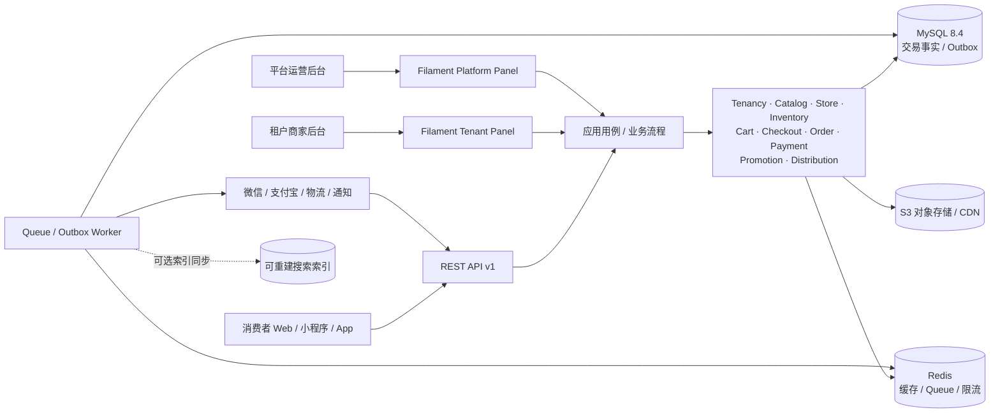

# LaFiDemo 电商 SaaS 总体方案与实施蓝图

> 文档性质：基于项目既有技术选型、架构蓝图和开发规范整理的系统方案。它描述目标和实现约束，不代表文中模块、接口、迁移或支付能力已经落地。实际开发以批准的 PRD、ADR、当前 `composer.lock` 和代码为准。

## 1. 建设目标与架构决策

构建 Laravel 13 + Filament 的多租户电商 SaaS，支持在线零售、O2O（门店履约/自提）及分销。系统对外提供 API，对内提供平台运营和租户商家后台；消费者 Web、小程序与 App 通过 API 解耦。

### 当前建议基线

| 领域 | 选择 | 边界/理由 |
| --- | --- | --- |
| PHP | PHP 8.4 最新安全补丁；最低约束 8.4.3 | 8.4.3 是 PHP-CGI CVE-2024-4577 修复下限，不是生产推荐补丁。组件组合以 `docs/architecture-components.md` 为准。 |
| 框架/后台 | Laravel 13、Filament 5 兼容版 | 模块化单体；Filament 只负责管理交互，不是授权边界。 |
| 主库 | MySQL 8.4 LTS | 订单/库存/支付事实、约束和本地事务的权威存储。 |
| 缓存/异步 | Redis + Laravel Cache/Queue；生产可用 Horizon | 缓存/锁不作为库存、支付或财务的事实来源。 |
| 文件 | S3 兼容存储 + CDN | 文件二进制不进入关系库；签名 URL 和租户访问需授权。 |
| 外部契约 | REST `/api/v1` + OpenAPI；Sanctum | 外部 API 版本独立于 Laravel 版本；保持兼容性。 |
| 架构 | 模块化单体 | 一个应用、明确领域边界、共享数据库事务；满足真实规模或隔离要求后再拆服务。 |

## 2. 系统上下文与业务流



所有入口（API、后台、队列、Webhook、导出）复用同一应用用例和服务端授权。搜索、缓存、报表、通知属于派生数据或副作用，不成为交易事实的唯一来源。

### 2.1 下单、库存与支付

建议的通用事务边界：

1. 从可信租户上下文解析租户、渠道、用户和履约范围；重新核价并验证促销、配送/自提资格。
2. 在短 MySQL 事务中检查幂等键、条件锁定可用库存、创建订单及商品/价格/地址快照、创建库存预占与 Outbox 事件。
3. 提交后再由 worker 调用支付渠道；外部 HTTP 调用不在数据库事务或持有行锁期间执行。支付尝试有独立状态和渠道幂等号。
4. 回调先验签并校验商户、金额、币种、订单关系、通知时间与事件唯一性，再通过受控状态机幂等落账。
5. 取消、超时、支付失败、支付成功与发货之间定义竞态规则。库存预占何时转为实际出库取决于仓储/��约策略，不应把“付款成功”一律等同“库存已出库”。
6. 所有本地状态变化与 Outbox 在同一事务提交。Outbox/Queue 采用至少一次投递假设；消费者幂等，失败有限重试、告警、可人工重放并能对账。

Redis 锁可减少重复工作，但不能替代数据库事务、行锁/条件更新、唯一约束和幂等状态机。库存并发测试必须验证不会超卖。

### 2.2 O2O 履约

订单需要显式记录 `sales_channel`、履约方式（配送/到店自提/门店发货）、服务门店和库存仓库分配。门店营业时间、配送范围、自提核销、截单策略分别建模。中央仓与门店仓库存分开管理；核销凭证使用短期随机 token，仅保存哈希，并执行限流、状态校验和审计。

### 2.3 分销与佣金

分销关系、规则版本、佣金账目和结算批次分开建模。佣金依据被冻结的订单/支付事实与适用规则计算；退款/拒付形成冲回或负向账目，不覆盖或删除原账目。分佣基数、层级、封顶、退款分摊和结算条件必须由业务负责人明确，AI/工程实现不能自行推断。

## 3. 模块职责与代码结构

```text
app/
├── Modules/
│   ├── Tenancy/       # Tenant、Membership、租户上下文、授权协作
│   ├── Catalog/       # Product、Variant/SKU、Category、Price
│   ├── Store/         # SalesChannel、Store、Warehouse、营业与履约配置
│   ├── Inventory/     # 余额、只追加流水、预占、分配与释放
│   ├── Cart/          # 购物车、购物车行；价格仅供预览
│   ├── Checkout/      # 结算校验、报价、PlaceOrder 编排
│   ├── Order/         # 订单、快照、状态历史、售后
│   ├── Payment/       # 支付尝试、渠道 adapter、回调、退款
│   ├── Promotion/     # 促销规则、券、使用与冲回
│   ├── Distribution/  # 分销关系、规则版本、佣金账本、结算
│   └── Shared/        # Money/Currency、Clock、ID 等少量稳定概念
├── Filament/
│   ├── Platform/      # 平台运营 Panel
│   └── Tenant/        # 租户员工 Panel
└── Providers/         # 容器绑定、模块启动

database/{migrations,factories,seeders}/
routes/{api,web}.php
tests/{Unit,Feature,Architecture,Support}/
```

模块内部依复杂度采用 `Domain / Application / Infrastructure / Http`。简单 CRUD 不机械套层。Controller、Form Request、Filament Resource/Action 负责边界输入、授权和响应，调用模块应用用例；禁止把关键副作用藏入 Observer、UI hook 或胖模型。跨模块写入仅通过公开应用接口/明确定义事件，不直接操纵对方内部表。

### 3.1 推荐应用流程

```text
Route / Filament Action
  → Middleware（认证、TenantContext、限流、request ID）
  → Form Request（结构和格式校验）
  → Policy / Gate（对象级权限）
  → Application Use Case（业务编排和事务边界）
  → Domain rules / Eloquent persistence / Provider adapter
  → API Resource / Filament response
```

业务不变量必须在应用用例/领域服务和数据库约束中保障，而不只依赖 UI 校验。

## 4. 身份、RBAC 与多租户隔离

- 起步采用共享库/共享表和显式 `tenant_id`。租户 ID 来源于认证用户的有效 membership，不信任 request body、URL 参数或客户端头。
- 平台身份和商家租户成员授权分开；首版可用 Laravel Policy/Gate + 租户成员/角色关系实现。RBAC 是权限模型，不应误作某个组件名；如后续选权限插件，先验证 Laravel 13 兼容性、安全维护和升级成本。
- 每个 tenant-owned 表、列表、关联选择器、导出、缓存 key、队列 payload、Webhook 和批量操作都保持租户范围。平台跨租户操作显式授权、记原因和审计。
- 数据库唯一键优先包含租户，例如 `(tenant_id, sku)`、`(tenant_id, order_no)`、`(tenant_id, provider, provider_event_id)`。核心关联尽可能使用租户组合约束；无法下沉到数据库时在应用校验并测试跨租户关联拒绝。
- 必须覆盖不同租户之间的读取、写入、导出和队列访问拒绝测试。Filament 隐藏页面/按钮不代表授权。

## 5. 领域模型与表结构方向

这是模型边界摘要；详细字段草图见 [`../doc/architecture-blueprint.md`](../doc/architecture-blueprint.md)，实施时以 migration 和批准 ADR 为准。

| 领域 | 核心实体/建议表 | 关键要求 |
| --- | --- | --- |
| SaaS/身份 | `tenants`, `users`, `tenant_memberships`, roles/permissions, `audit_logs` | 角色绑定 tenant membership；平台角色与租户角色分离。 |
| 渠道/门店 | `sales_channels`, `stores`, `store_business_hours`, `warehouses` | 门店履约与渠道明确归属租户；门店仓与中央仓区别。 |
| 商品 | `products`, `product_variants`, `categories`, `product_media`, `prices` | SKU 是库存单位；价格有币种、渠道和生效时间。 |
| 库存 | `inventory_balances`, `inventory_movements`, `inventory_reservations` | 余额用于快速读取，流水只追加；调整记录原因、操作者与幂等键。 |
| 购物车/订单 | `carts`, `cart_items`, `orders`, `order_items`, `order_addresses`, `order_adjustments`, `order_status_histories` | 结算重新核价；历史订单的商品、价格、税费、地址、配送方式保存快照。 |
| 支付/售后 | `payments`, `payment_events`, `refunds`, `returns`, `shipments`, `pickup_verifications` | 订单/支付/履约状态分离；回调事件去重；退款金额不得超过可退余额。 |
| 促销 | `promotions`, `coupons`, `coupon_redemptions` | 规则版本化，优惠分摊冻结到订单，冲回留痕。 |
| 分销账务 | `distribution_relationships`, `commission_rules`, `commission_entries`, `settlements`, `settlement_items` | 佣金不可覆盖重算；冲回追加负向关联账目。 |
| 可靠集成 | `idempotency_keys`, `outbox_messages`, optional `webhook_deliveries` | 事务 Outbox、唯一约束、有限重试和人工对账。 |

### 5.1 通用数据约定

- 金额持久化为 ISO 4217 货币最小单位整数 + `currency_code`；业务计算使用 Brick Money 等精确运算和明示舍入策略。不能假设所有币种两位小数，禁止 `float`。
- 订单行记录商品名、SKU、规格、单价、数量、优惠/税费分摊等下单快照；订单地址/履约快照不随客户档案修改。
- 时间写 UTC，显示按 tenant/store IANA 时区转换。业务 ID（order number、SKU、provider transaction ID）与内部主键分开。
- 交易/财务事实（库存流水、支付事件、退款、佣金条目、审计）禁止普通级联删除。金额、状态和来源需要可追踪。
- 结构化列优先；JSON 只用于低频可变配置或受控快照，不把关系模型整体塞进 JSON。
- 每张 tenant-owned 表建立合理的租户索引与唯一约束；根据真实查询用 `EXPLAIN` 和压测校准索引。

## 6. API 与管理后台约定

### REST API

- 路由版本 `/api/v1`；使用 Form Request、Policy/Gate、Resource 白名单序列化。
- 统一分页（限制最大页长）、筛选/排序白名单、稳定错误码、request/correlation ID、限流与弃用规则。
- 写操作对下单、支付、退款、库存调整等副作用实现幂等；同一个 idempotency key 但不同请求体返回冲突。
- OpenAPI 描述认证、参数、错误、幂等、分页与兼容策略。Sanctum 认证不等于拥有目标租户资源权限。
- Webhook 验签、时间窗、账户/商户、币种金额、资源关联与事件唯一性；先持久化可靠事件再返回成功确认，避免网络重试丢通知。

### Filament

- 至少两个明确的 Panel：平台运营和租户商家。业务用例可共用，认证入口、导航和授权策略分离。
- Resource 页面可见性只影响 UI；实际读取和写入必须执行 Policy 和 TenantContext 检查。
- 不提供直接改订单支付状态、佣金账目、库存事实字段的普通表单。退款、改价、库存调整等高风险动作需要二次确认、操作原因、审计与幂等保护。
- 报表和大批量导出使用后台 Job，Job 只接收必要 ID 与显式租户上下文；导出下载重新校验权限并使用短期签名链接。

## 7. Composer 基础组件与使用边界

具体约束和 PHP 安全决策见 [`architecture-components.md`](architecture-components.md)。当前建议组件：

| 需求 | Composer/平台组件 | 约束 |
| --- | --- | --- |
| CSV/XLSX 导出 | OpenSpout | 大数据流式写出；队列执行、租户过滤、CSV 公式注入防护。复杂 Excel 模板才评估 PhpSpreadsheet/Maatwebsite。 |
| PDF | Laravel Dompdf | 适合订单/简单报表；限制远程资源、本地文件访问，验证中文字体与内存上限。 |
| 微信/支付宝 | Yansongda Pay | 置于统一 Payment adapter 后；沙箱验签和回调重复测试，不将 SDK 当业务状态机。 |
| QR | chillerlan QR Code | QR 只装载短期 token/URL；授权仍由服务端验证。 |
| 图片处理 | Intervention Image + GD | 文件类型/像素/大小��制，重型任务队列处理。 |
| 金额 | Brick Money + MySQL 整数存储 | 币种精度和舍入规则显式化；禁止浮点。 |
| 内部唯一 ID | Laravel ULID/UUID helper | 数据库唯一约束是最终防线；业务订单号单独生成并做冲突重试。 |
| RBAC | Laravel Policy/Gate 起步 | 权限包按真实需求评估，不把后台可见性当服务端授权。 |

不要重复引入实现重叠功能的包。每次加入/升级依赖都审查维护、许可证、PHP/Laravel 兼容和 `composer audit` 结果，锁定 `composer.lock`。

## 8. 测试、质量与安全要求

每个模块至少提供 Unit 与 Feature 测试。关键测试包括：

- 跨租户读取/写入/导出/API/后台/队列均拒绝；平台角色按显式授权执行跨租户操作。
- 重复下单只产生一次订单与库存预占；相同幂等键不同 payload 冲突。
- 并发预占不会超卖；取消/过期释放只发生一次，库存流水可对账。
- 订单快照在商品/价格变更后不变，优惠金额和币种舍入满足业务规则。
- 支付回调非法签名拒绝；重复/乱序事件不会重复入账；退款累计不超额。
- O2O 自提核销令牌过期、重放、跨店使用均拒绝；分销退款产生佣金冲回而不删除原记录。
- Filament 高风险 Action 强制 Policy；导出含权限范围并防止 CSV formula injection。
- Outbox 发布失败可重试/恢复，消费者重复处理安全；外部网络调用不在持锁事务内。

CI 建议：Composer lock 校验/安全审计 → Pint → Larastan/PHPStan → Pest → 真实 MySQL 8.4/Redis 集成测试 → 空库迁移/种子验证 → 可追溯制品构建。不得只用 SQLite 假设覆盖 MySQL 并发/约束语义。

## 9. 分阶段实施路线

### 阶段 1：工程与租户基座

Laravel 13 + Filament 5 项目骨架、PHP 8.4 容器、Composer lock、CI、MySQL/Redis、日志/健康检查；租户、membership、基本角色、TenantContext、两个 Filament Panel；完成租户隔离测试。

### 阶段 2：商品、门店与库存

销售渠道、门店、仓库、商品/SKU、价格、媒体、库存余额/流水/预占；后台管理与商品只读 API；库存并发和跨租户测试。

### 阶段 3：购物车、结算与订单

购物车、重新核价、优惠分摊、订单快照、状态历史、幂等下单、Outbox；超时关单与库存释放；验证事务回滚和并发。

### 阶段 4：支付、售后与履约

Payment adapter、微信/支付宝沙箱、回调验签与去重、退款；配送/自提/门店发货、核销；支付竞态、退款上限、队列重试与对账。

### 阶段 5：促销与分销

促销/券、规则版本、佣金账本、冲回和结算；必须由产品明确佣金规则与财务流程，配对账报告及退款覆盖。

### 阶段 6：运营化

队列告警、备份恢复演练、审计/隐私保留、限流、搜索（如确有需求）、压测、灰度发布和事故流程。

每阶段交付可运行代码、migration、工厂/种子、授权、核心测试、API/后台操作说明；不得将本设计稿描述为已经上线的完整系统。

## 10. 来源与设计参考

- 项目内部基线：[`docs/architecture.md`](architecture.md)、[`docs/architecture-components.md`](architecture-components.md)、[`../doc/architecture-blueprint.md`](../doc/architecture-blueprint.md)、[`../doc/technology-selection.md`](../doc/technology-selection.md)、[`rules/`](rules/)。
- 框架、组件与安全支持以当前官方文档、包仓库和 PHP 安全公告为准。版本约束经过 Composer 实际解析并生成锁文件之前仅是目标范围，不是验证结果。
